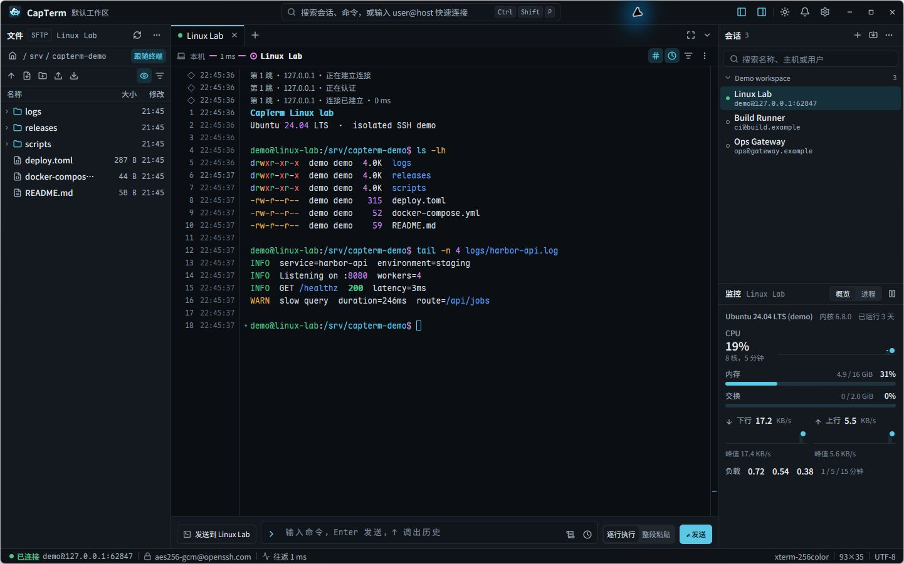
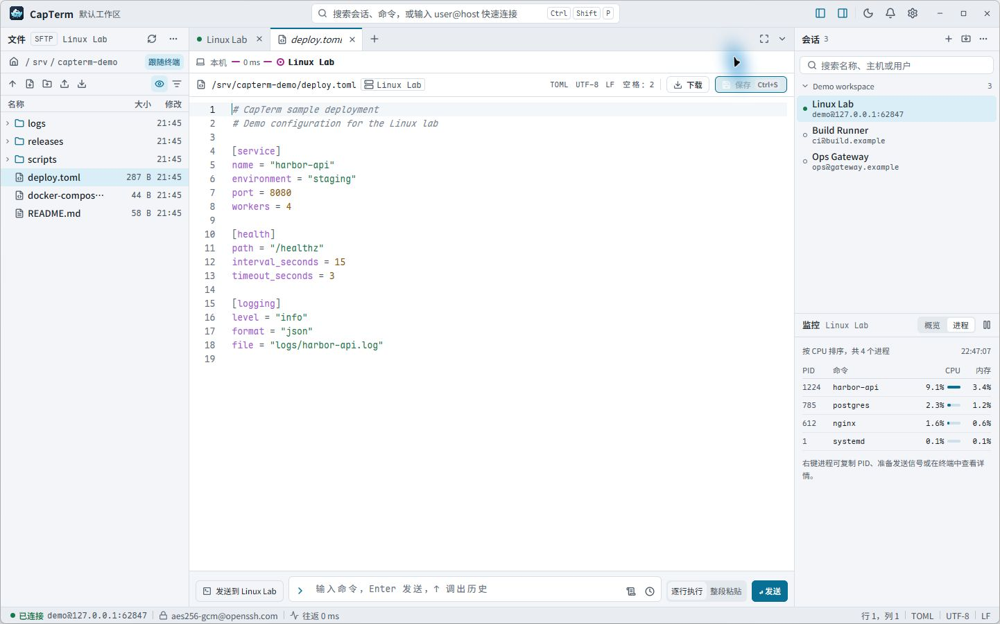

# CapTerm

[简体中文](README.md) · **English**

CapTerm is a native SSH workbench built with Rust and [GPUI Kit](https://github.com/longbridge/gpui-kit). Use the terminal, browse SFTP files, edit remote text, and monitor the host in one window. On Windows, PowerShell, Command Prompt, and WSL can run in neighboring tabs.

[Download for Windows x64](https://github.com/yulianjie/capterm/releases/latest) · [Quick start](#quick-start) · [Build and release](#build-and-release)



## Features

- **SSH sessions and jump hosts.** Save, group, and search sessions, or connect directly with `user@host[:port]`. The route shows handshake and authentication progress for each hop. Reuse multi-hop routes, test connections, configure network proxies, and set up local, remote, or dynamic TCP forwarding.
- **OpenSSH configuration.** Preview the import, then link the configuration file for future sync or copy its hosts as local sessions. The preview flags skipped entries and unsupported options. Export local sessions as OpenSSH configuration snippets.
- **Terminal and send bar.** Scrollback includes logical line numbers, timestamps, and command blocks. Search by text or regular expression, with optional case sensitivity. The send bar runs commands line by line or pastes the whole draft, with per-session history and reusable snippets. Full-screen programs such as vim and htop use the alternate-screen layout. The send bar defaults to whole-draft paste when it detects an agent CLI such as Codex or Claude Code.
- **SFTP and remote editing.** Let the file pane follow the terminal's current directory, drag files in to upload, or drag remote files out to Windows File Explorer. The transfer queue shows progress and conflicts. Click a remote text file to preview or edit it in a tab. CapTerm checks the remote version on save, and you can compare changes or reload when a conflict occurs. Overwriting a file from the editor requires the server's OpenSSH `posix-rename@openssh.com` extension.
- **Local files.** Browse Windows files from PowerShell and Command Prompt tabs, and Linux files from the WSL distribution, in the left file pane. The pane can follow the terminal directory, and Linux text files in WSL open in a read-only preview.
- **Host monitoring and layout.** View CPU, memory, disk, network, load, and process data through the current SSH connection without installing a collector on the server. Available metrics vary by remote operating system. The workbench has dark and light themes, collapsible sidebars, and a focus mode.



The screenshots show CapTerm's Chinese interface running against an isolated local SSH demo host with sample terminal output, remote files, and metrics. See the [design notes and interactive prototype](design/README.md) for more scenarios. Customize SSH and WSL terminal text highlighting with the [Linux highlight rules](docs/linux-highlights.md).

## Download

Get the Windows x64 build from [GitHub Releases](https://github.com/yulianjie/capterm/releases/latest).

| File | How to use it |
| --- | --- |
| `*-setup.exe` | Install for the current user and create a Start menu shortcut. |
| `*-portable.zip` | Extract the archive and run `capterm.exe`. |
| `SHA256SUMS.txt` | Run `Get-FileHash -Algorithm SHA256` on a downloaded file and compare the result. |

## Quick start

1. Press `Ctrl+Shift+P` to open the command palette and enter `user@host[:port]`. You can also double-click a saved session on the right or import OpenSSH configuration from the session pane.
2. On first connection, verify the host key fingerprint and choose whether to trust it for this connection or save it in CapTerm's own `known_hosts` file. To replace a saved key, enter the corresponding hostname.
3. Run commands in the terminal or open a remote text file from the SFTP pane on the left. After SSH disconnects, press `Enter` in the terminal or click the reconnect prompt to reconnect in the current tab. Press `Ctrl+Shift+F` to search terminal output and `Ctrl+Shift+Enter` to toggle focus mode.

Password authentication is available for the target host. Jump hosts use a private key or SSH agent. Load encrypted private keys into your local SSH agent.

## Build and release

Building on Windows x64 requires Rust 1.95 or later with the MSVC toolchain, Visual Studio C++ Build Tools, and the Windows SDK.

```powershell
cargo run --locked
cargo test --locked
```

Local packaging requires Inno Setup 6.3 or later in the 6.x series and PowerShell 7. Set `-Version` to the version in `Cargo.toml`. Packages are written to `dist/`.

```powershell
cargo build --release --locked
./scripts/package-windows.ps1 -Version 0.1.0 -Executable target/release/capterm.exe
```

The [Windows build and release workflow](https://github.com/yulianjie/capterm/actions/workflows/windows.yml) checks formatting, runs tests, and verifies the portable package and the install and uninstall flows. It runs on pushes to `main`, pull requests targeting `main`, and manual dispatch. To release, update the version in `Cargo.toml` and `Cargo.lock`, push the commit to `main`, and push the matching `vX.Y.Z` tag. The workflow checks that the tag matches the project version and publishes the installer, portable archive, and checksums to GitHub Releases.

```powershell
git tag -a v0.1.0 -m "CapTerm v0.1.0"
git push origin v0.1.0
```

## License

CapTerm uses the [Apache License 2.0](LICENSE). The bundled [Microsoft ConPTY and OpenConsole](assets/windows/conpty/LICENSE) use the MIT license. [Maple Mono NF CN](assets/fonts/MapleMono-OFL.txt) and [Noto Sans SC](assets/fonts/NotoSansSC-OFL.txt) use the SIL Open Font License 1.1. See the [Lucide and Feather notices](assets/licenses/Lucide-Feather.txt) for icon licensing.
