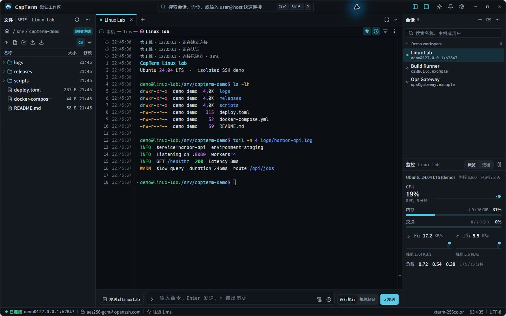
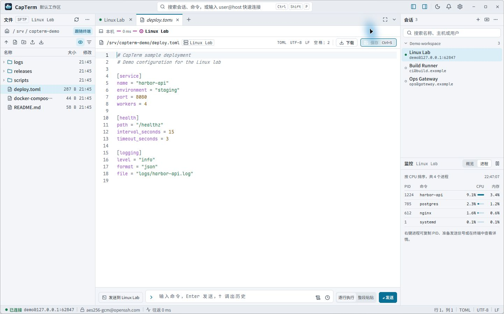

# CapTerm

**简体中文** · [English](README.en.md)

CapTerm 是用 Rust 和 [GPUI Kit](https://github.com/longbridge/gpui-kit) 构建的原生 SSH 工作台。你可以在一个窗口里操作终端、浏览 SFTP 文件、编辑远程文本并查看主机状态。Windows 上也可以在同一标签栏中打开 PowerShell、命令提示符和 WSL。

[下载安装包](https://github.com/yulianjie/capterm/releases/latest) · [快速开始](#快速开始) · [构建与发布](#构建与发布)



## 功能

- **SSH 会话与跳板**。保存、分组和搜索会话，或直接用 `user@host[:port]` 连接。航线逐跳显示握手与认证状态。支持多级跳板复用、连接测试、网络代理，以及本地、远程和动态 TCP 转发。
- **OpenSSH 配置**。逐项预览导入结果，将配置文件链接为可同步的会话，或复制为本地会话。预览会列出跳过的配置和不适用的选项。本地会话可导出为 OpenSSH 配置片段。
- **终端与发送栏**。滚动历史带逻辑行号、时间戳和命令块，支持文本和正则表达式搜索，可选择区分大小写。发送栏支持逐行执行、整段粘贴、会话历史和可复用的命令片段。运行 vim、htop 等全屏程序时，终端切换到备用屏幕布局。识别到 Codex、Claude Code 等 Agent CLI 时，发送栏默认使用整段粘贴。
- **滚屏历史上限**。每个终端标签默认保留 10,000 行历史。可在「设置 → 终端 → 滚屏历史」调整，新打开的标签使用新上限。超出上限的旧行会被淘汰，无法再搜索或导出。
- **SFTP 与远程编辑**。让文件面板跟随终端当前目录，拖入文件上传，或把远程文件拖到 Windows 资源管理器。传输队列显示进度与冲突。单击远程文本可在标签中预览和编辑，保存时检查远端版本。遇到冲突时可查看差异或重新加载。覆盖保存需要服务端支持 OpenSSH 的 `posix-rename@openssh.com` 扩展。
- **本地文件**。在左侧面板浏览 PowerShell 和 CMD 的 Windows 文件，以及 WSL 发行版中的 Linux 文件。文件面板可以跟随终端目录，WSL 中的 Linux 文本以只读方式预览。
- **主机监控与布局**。通过当前 SSH 连接查看 CPU、内存、磁盘、网络、负载和进程，无需在服务器安装采集程序。可用指标随远端系统而异。工作台提供深色和浅色主题、可收起的侧栏和专注模式。



截图来自实际运行的 CapTerm，使用本机隔离的 SSH 演示环境。终端输出、远程文件和监控数据均为示例。更多场景见[设计说明和交互原型](design/README.md)。SSH 与 WSL 的终端文本高亮可通过 [Linux 高亮规则](docs/linux-highlights.md)自定义。

## 下载

从 [GitHub Releases](https://github.com/yulianjie/capterm/releases/latest) 选择对应系统和架构的安装包。

| 系统 | 文件与安装方式 |
| --- | --- |
| Windows x64 | 运行 `*-setup.exe`，或解压 `*-portable.zip` 后运行 `capterm.exe`。 |
| macOS 15 及以上 | Apple Silicon 选择 `*-macos-arm64.dmg`，Intel 选择 `*-macos-x86_64.dmg`。打开磁盘映像，把 CapTerm 拖到「应用程序」。 |
| Ubuntu 24.04 | x86-64 选择 `*-linux-amd64.deb`，ARM64 选择 `*-linux-arm64.deb`。使用 `sudo apt install ./<文件名>.deb` 安装，需要支持 Vulkan 的图形环境。 |

Windows 包的校验值在 `SHA256SUMS.txt`，macOS 和 Linux 包的校验值在 `SHA256SUMS-unix.txt`。可分别用 `Get-FileHash -Algorithm SHA256`、`shasum -a 256` 或 `sha256sum` 核对。

macOS 包使用临时签名，未经过 Apple 公证。首次打开时，系统可能要求在「系统设置 → 隐私与安全性」中选择「仍要打开」。PowerShell、CMD、WSL 和将 SFTP 文件拖出窗口的功能仅在 Windows 提供。

## 快速开始

1. 按 `Ctrl+Shift+P` 打开命令面板，输入 `user@host[:port]` 连接。也可以双击右侧已保存的会话，或从面板导入 OpenSSH 配置。
2. 首次连接时，核对主机密钥指纹，再选择仅本次信任或保存到 CapTerm 的独立 `known_hosts`。替换已保存的密钥需要输入对应主机名。
3. 连接后在终端运行命令，或从左侧 SFTP 面板打开远程文本。SSH 断开后，在终端按 `Enter` 即可在当前标签重连，也可以点击重连提示。按 `Ctrl+Shift+F` 搜索终端输出，按 `Ctrl+Shift+Enter` 切换专注模式。

密码用于目标主机认证，跳板使用私钥或 SSH Agent。加密私钥可先加载到本机 SSH Agent。

## 构建与发布

在 Windows x64 上构建需要 Rust 1.95 或更高版本的 MSVC 工具链、Visual Studio C++ Build Tools 和 Windows SDK。
macOS 构建需要 Rust 1.98 或更高版本和 Xcode 工具链。

```powershell
cargo run --locked
cargo test --locked
```

本地打包需要 Inno Setup 6.3 或更高的 6.x 版本和 PowerShell 7。将 `-Version` 设为 `Cargo.toml` 中的版本号，生成的文件位于 `dist/`。

```powershell
cargo build --release --locked
./scripts/package-windows.ps1 -Version 0.1.0 -Executable target/release/capterm.exe
```

[Windows build](https://github.com/yulianjie/capterm/actions/workflows/windows.yml) 在推送到 `main`、面向 `main` 的 PR 和手动运行时验证 Windows 构建。发布时更新 `Cargo.toml` 和 `Cargo.lock` 中的版本号，把提交推送到 `main`，再推送对应的 `vX.Y.Z` 标签。[Desktop release](https://github.com/yulianjie/capterm/actions/workflows/release.yml) 核对标签与项目版本，待 Windows、macOS 和 Linux 构建及验证通过后，将安装包和校验文件发布到 GitHub Releases。也可以从 `main` 手动运行该工作流，按已发布的标签补充 macOS 和 Linux 包。

```powershell
git tag -a v0.1.0 -m "CapTerm v0.1.0"
git push origin v0.1.0
```

## 许可证

CapTerm 使用 [Apache License 2.0](LICENSE)。随应用分发的 [Microsoft ConPTY 和 OpenConsole](assets/windows/conpty/LICENSE) 使用 MIT 许可证。[Maple Mono NF CN](assets/fonts/MapleMono-OFL.txt) 和 [Noto Sans SC](assets/fonts/NotoSansSC-OFL.txt) 使用 SIL Open Font License 1.1。图标的许可见 [Lucide 和 Feather 声明](assets/licenses/Lucide-Feather.txt)。
