# CapTerm 设计稿

CapTerm 是一个用 Rust 和 [gpui-kit](https://github.com/longbridge/gpui-kit)（0.9）开发的 SSH 远程管理桌面程序。本目录是它的设计稿：高保真交互原型、导出的画板、设计说明，以及能直接被 gpui-kit 加载的主题文件。

| 想看什么 | 打开 |
| --- | --- |
| 全部画板与设计要点 | [`index.html`](index.html) |
| 可点击的交互原型 | [`prototype/index.html`](prototype/index.html) |
| 导出的 PNG 画板（2 倍图） | [`exports/`](exports/) |
| 默认应用图标「破浪船艏」 | [SVG 源稿](icon/capterm.svg) · [512 px PNG](icon/capterm.png) · [Windows ICO](icon/capterm.ico) |
| 新图标「舵轮」：黄铜舵轮，轮毂是终端屏幕 | [设计说明](icon/helm/README.md) · [SVG 源稿](icon/helm/capterm-helm.svg) · [预览](icon/helm/preview.png) · [Windows ICO](icon/helm/capterm-helm.ico) |
| 全部六个图标方案 | [图标方案](icon/concepts/README.md) |
| 原船长帽图标 | [SVG 源稿](icon/archive/captain-cap.svg) · [512 px PNG](icon/archive/captain-cap.png) · [Windows ICO](icon/archive/captain-cap.ico) |
| gpui-kit 主题（深色 / 浅色） | [`theme/capterm.theme.json`](theme/capterm.theme.json) |
| 终端配色（ANSI 16 色、行号列等） | [`theme/terminal-colors.json`](theme/terminal-colors.json) |
| 重新导出画板 | `node design/tools/export.mjs`（需要本机装有 Chrome 或 Edge） |

原型直接双击打开即可，不需要服务器。用 URL 参数切换场景：`prototype/index.html?scene=agent&theme=light`。可选场景：`workbench`、`search`、`agent`、`tui`、`editor`、`upload`、`session`、`import`、`connect`、`settings`。浏览器会占用部分 Ctrl+Shift 组合键（如 Ctrl+Shift+N/T/W），原型里这几个快捷键无法演示。

```
design/
├── README.md              设计说明（本文件）
├── index.html             画板总览
├── prototype/             交互原型：index.html、tokens.css、styles.css、app.js、data.js、icons.js
├── exports/               11 张 PNG 画板
├── icon/                  应用图标（SVG、PNG、ICO）与备选方案
├── theme/                 capterm.theme.json、terminal-colors.json
└── tools/                 export.mjs 导出画板，export-icon.mjs 导出舵轮图标
```

---

## 1. 设计目标

1. **一个窗口完成日常运维**：连接（含多级跳板）、远程文件、终端、主机状态，同时可见，不用切窗口。
2. **终端可追溯**：每一行都有行号和写入时间，命令有退出码和耗时，几个小时前的输出也能定位到具体时刻。
3. **对 TUI 和 Agent CLI 友好**：vim、htop、tmux 以及 Claude Code、Codex、Gemini CLI 等程序的显示、按键、粘贴、通知都按真实终端的标准实现。
4. **深色、浅色两套等价主题**：不是简单反色，每个颜色在两种主题下单独取值并校验对比度。

## 2. 视觉方向：航线

把每一次连接看作一条航线：从本机出发，经过跳板机，到达目标主机。航线是整个产品**唯一的强调元素**，用品红色表示（借用驾驶舱导航屏用品红标出当前航路的惯例）。其余界面保持安静，把注意力留给终端内容。

| 颜色角色 | 深色（夜航） | 浅色（白昼） | 只用于 |
| --- | --- | --- | --- |
| 航线 route | `#E07AE0` | `#A62C95` | 连接链路：航线条、会话列表的跳数图形、跳板编辑器、Logo |
| 强调 accent | `#5CC8E6` | `#086F95` | 可交互、选中、焦点、主按钮、当前值、图表线 |
| 正常 ok | `#4CC38A` | `#157A4B` | 已连接、命令成功 |
| 注意 caution | `#E8B04A` | `#8F5C00` | 连接中、资源偏高、待处理冲突、广播发送 |
| 故障 danger | `#F0626A` | `#BE2E3A` | 连接失败、命令失败、资源告急 |

规则：

- 状态从不只靠颜色表达，一定同时有图标或文字（例如「偏高」配三角图标，已连接是实心圆点、未连接是空心圆环）。
- 正文与次要文字对比度 ≥ 4.5:1，界面图形 ≥ 3:1；完整取值和对比度见 [`prototype/tokens.css`](prototype/tokens.css)。
- 字体：界面用 **Noto Sans SC**；终端、编辑器、路径、主机名用 **Maple Mono NF CN**。后者中文字宽严格等于两个英文字宽（实测 15.6px : 7.8px），TUI 边框和表格不会因为中文错位，同时自带 Nerd Font 图标，兼容 starship、powerlevel10k 这类提示符。两者均为 OFL 授权，可以随程序分发。
- 形状：按钮、输入框圆角 6px；对话框、浮层 10px；标签 4px。停靠面板之间只用 1px 分隔线，不加阴影；只有浮层（对话框、菜单、通知、拖拽预览）有阴影。
- 动效：只用于响应操作（连接时航线逐跳点亮、展开折叠），不做装饰性动画；系统开启「减少动态效果」时全部关闭。

## 3. 整体布局

参考 WindTerm 的停靠式布局：左右两栏和底部输入栏围绕中间的终端，信息密度高但层次清楚。

```
┌ 标题栏 40 ──────────────────────────────────────────────────────────────────────┐
│ ◉ CapTerm   [ 搜索会话、命令，或输入 user@host 快速连接   Ctrl Shift P ]   ▯ ▯ ☀ 🔔 ⚙ │
├ 文件 272 ────────┬ 标签栏 34 ─────────────────────────────────┬ 会话 296 ──────────┤
│ 文件 SFTP  ↻ ⋯   │ ● prod-api-01 × │ ● staging │ compose.yaml ● │ +    │ 会话 11   + ⇩ ⋯   │
│ ⌂ /srv/api/current│ 航线条 32：本机 ─12ms─ ● edge-bastion ─9ms─ ● core-gw ─17ms─ ◉ prod-api-01 │
│ ↑ ⊕ ⊞ ⇡ ⇣    👁 ⚲ ├──────────────────────────────────────────────┤ [搜索名称、主机或用户]│
│ 名称   大小  修改 │ 行号 时间     │ 终端内容                      ✓ 0.6 秒│ ▾ 生产环境       5 │
│ ▸ config    11-05│ 1186 10:41:52 ▾ deploy@prod-api-01:~$ docker ps     │   ● prod-api-01 ●─●─◉│
│ ▾ logs      10:41│ 1187 10:41:52 │ NAME   IMAGE   SERVICE   STATUS     │   ○ prod-db-01      │
│   app.log  18 MB │ ……                                          ▕概览条│ ▾ ~/.ssh/config    │
│ compose.yaml ●   │ 1212 10:49:40 ▸ deploy@prod-api-01:~$ █             ├ 监控 424 ─────────┤
│ ……               │                                              │ CPU 24%  ╱╲_╱‾╲_● │
├ 传输（可折叠）───┤                                              │ 内存 ████████░ 65% │
│ ⇡ build.zip 62%  ├ 输入栏 ≥49 ──────────────────────────────────┤ 磁盘 /data ⚠ 81%   │
│ ⇣ access.log 31% │ [发送到 prod-api-01 ▾] ❯ 输入命令…  [逐行|整段] [发送]│ ↓12.4  ↑1.2 MB/s │
├ 状态栏 24 ──────┴──────────────────────────────────────────────┴───────────────────┤
│ ● 已连接 deploy@prod-api-01 │ 🔒 chacha20-poly1305 │ 往返 38 ms      xterm-256color │ 91×35 │ UTF-8 │ ⇡ 2 个传输 │
└──────────────────────────────────────────────────────────────────────────────────┘
```

| 区域 | 默认 | 可调范围 | 说明 |
| --- | --- | --- | --- |
| 标题栏 | 40px | 固定 | 自绘标题栏，Windows 窗口按钮在右侧，macOS 红绿灯在左侧 |
| 左栏：文件 | 272px | 220–480px | 可隐藏（Ctrl+Shift+E） |
| 右栏：会话 + 监控 | 296px | 260–440px | 可隐藏（Ctrl+Shift+B）；上下比例可拖动，监控默认 424px |
| 标签栏 / 航线条 | 34px / 32px | 固定 | 航线条属于当前标签 |
| 输入栏 | 49px | 1–6 行自动增高 | 全屏程序运行时收起为 34px 提示条 |
| 状态栏 | 24px | 固定 | |

窗口变窄时：宽度 < 1200px，右栏收成 44px 图标栏（会话、监控、导入），点击后以浮层展开；< 900px，左栏也收起。专注模式（Ctrl+Shift+Enter）只保留标签栏、终端和输入栏。见画板 11。

拖动左右栏的分隔线后保存宽度，下次打开时恢复。窗口空间不足时按当前窗口大小显示，重新拉宽窗口后恢复保存的宽度。

实现上用 `h_resizable` / `v_resizable` 组合出三栏与右栏上下分割即可；如果需要让用户拖动面板改变停靠位置并持久化布局，改用 `dock::DockArea` + `DockSkin`（`DockPlacement::Left / Right / Bottom / Center`）。

## 4. 各区域设计

### 4.1 标题栏

- 左：Logo（一条两站的小航线）、产品名、当前工作区。
- 中：命令面板入口（Ctrl+Shift+P）。可以搜索会话和命令；输入 `user@host[:port]` 时第一项变成「连接到 …」，回车直接连接，不需要先保存会话。
- 右：左栏 / 右栏显示开关、主题切换（深色时显示太阳，浅色时显示月亮）、通知、设置、窗口按钮。

### 4.2 文件管理（SFTP）

**结构**：路径栏（主目录按钮 + 可点击的路径面包屑 + 「跟随终端」开关）→ 工具栏（上一级、新建文件、新建文件夹、上传、下载、显示隐藏文件、筛选）→ 树形列表（名称 / 大小 / 修改时间）→ 可折叠的传输队列。

- **跟随终端**：开启后，文件面板随终端中的 `cd` 切换目录。优先读取 Shell 上报的 OSC 7。远端未上报时，CapTerm 在提示符出现后（OSC 133 或提示符识别）通过同一条 SSH 连接查询 Linux 交互式 Shell 的工作目录。无法读取该进程时，尝试从提示符提取路径。文件面板访问的是 SSH 服务器的 SFTP 文件系统，终端进入另一个文件系统时，两者可见的路径可能不同。
- **修改时间**：今天的文件显示「10:41」，其余显示「11-05」，完整时间放在悬停提示里，保证 272px 宽度下文件名不被截断。
- **点击编辑**。单击文本文件会在中间区域打开独立标签。可以依次打开多个文本文件，再单击已打开的文件会切换到它的标签。

| 文件 | 行为 |
| --- | --- |
| 文本文件且 ≤ 5 MB | 可编辑。判定为文本：前 8 KB 不含 NUL，且能按 UTF-8（或用户指定的 GBK 等编码）解码 |
| 文本文件 5–50 MB | 只读打开前 1 MB，提供「下载后用本机程序打开」 |
| 二进制文件或 > 50 MB | 单击只选中；双击下载到临时目录并用系统默认程序打开 |

- **保存**（Ctrl+S）：先写入同目录的临时文件，再原子 rename 覆盖，失败时远端原文件不变；保留原权限和属主。保存前比对远端 mtime 和大小，若打开后被他人改动，编辑器顶部出现提示条「远端文件已更新」，提供「比较差异 / 重新加载 / 仍然保存」，比较差异用 gpui-kit 的 `Diff` 组件。
- **拖拽上传**：从系统文件管理器拖入：
  - 悬停在文件夹行上：该行高亮为投放目标，上传到这个文件夹；
  - 悬停在空白处：上传到当前目录；
  - 列表底部出现投放提示「松开以上传 2 个文件到 /srv/api/current/logs」；
  - 拖到终端区域：上传到终端当前目录，并把远端路径插入输入栏（给 Agent CLI 发图片、日志时很方便）。
- **拖拽下载**：把文件行拖到桌面或资源管理器。Windows 上用 `IDataObject` 的延迟渲染：放下时才开始下载到临时目录，完成后交给系统完成复制；macOS 用 file promise。也可以右键「下载到…」。把文件行拖进终端或输入栏，会插入带引号的远端路径。
- **传输队列**：每项显示方向、名称、进度条、百分比、速度、剩余时间、目标位置；可暂停 / 取消。**同名冲突不弹模态框**，而是在队列项里原地询问「覆盖 / 跳过 / 保留两者」，并可勾选「其余冲突同样处理」，其它传输继续进行。默认同时传输 3 个文件，保留修改时间与权限。
- **右键菜单**：打开 / 编辑、下载到…、复制路径、在终端中 cd 到此处、重命名、删除、修改权限（chmod）、新建文件 / 文件夹、刷新。

### 4.3 终端

#### 标签栏

每个标签：状态点（实心绿 = 已连接，琥珀圆环 = 连接中，红 = 失败）+ 会话名 + 关闭按钮。检测到 Agent CLI 时显示机器人图标；后台标签收到程序通知（OSC 9 / 777 或响铃）时显示「待确认」徽标，切过去后消失。编辑器标签显示文件图标，未保存时用圆点代替关闭按钮。

#### 航线条

当前标签的连接链路：`本机 ─ 12 ms ─ ● edge-bastion ─ 9 ms ─ ● core-gw ─ 17 ms ─ ◉ prod-api-01`。

- 站点是跳板机，空心圆环是目标主机；线段上标注这一跳的往返延迟，悬停站点显示 `user@host:port` 和认证方式。
- 连接中：已建立的线段为实线，正在建立的线段是流动的琥珀色虚线，未开始的是灰色虚线；目标站点显示当前步骤（如「等待确认主机密钥」）。
- 失败：出错的那一跳线段和站点变红，悬停显示原因和建议，例如「core-gw 认证失败（publickey）：检查第 2 跳的私钥，或改用 SSH Agent」。
- 右侧：Agent 或全屏程序状态标签，以及行号、时间戳、搜索、更多（复制 SSH 命令、复制 / 导出带行号和时间的日志、重新连接、断开）。

#### 行号与时间戳（核心规则）

| 规则 | 说明 |
| --- | --- |
| 行号 | 按会话累计的**逻辑行**编号（软换行的续行不增加行号）。回滚缓冲区丢弃最早的行时，行号不重排 |
| 时间戳 | 该行最后一次被写入的时间，格式可选 `时:分:秒`、`时:分:秒.毫秒` 或相对时间 |
| 重复时间 | 与上一行同一秒时用更淡的颜色显示，让命令的开始时间一眼能扫到 |
| 空闲间隔线 | 默认隐藏。可在「设置 → 终端」中开启，开启后相邻两行间隔超过 60 秒（可设置）时插入一条细线并标注「空闲 4 分 51 秒」 |
| 命令块 | 依据 OSC 133（A/B/C/D）把提示符和它的输出组成块：提示符行左侧有折叠箭头，右侧显示 ✓ 耗时 或「退出码 1」；输出行左侧有块参考线。没有 shell 集成时用提示符正则回退识别 |
| 实时区 | 正在被程序反复重绘的行（`\r` 进度条、Claude Code 这类内联 TUI 的输入框）时间列显示「实时」，左侧有强调色竖条；滚入历史后时间定格 |
| 全屏程序 | 程序切换到备用屏幕（vim、htop、less）时，行号列显示屏幕行号 1…N，时间列留空，全屏期间的内容不计入累计行号；退出时插入一条系统行「已退出全屏程序 vim，用时 1 分 12 秒」 |
| 系统行 | CapTerm 自己输出的信息（逐跳连接日志、断开原因）用界面字体和图标，不占行号 |
| 不占终端列数 | 行号列和时间列画在终端网格之外，`cols` 只按内容区宽度计算；切换显示会触发一次 resize（防抖 100ms） |
| 复制 | 普通复制不带行号和时间；右键「复制（含行号与时间）」和「导出会话日志」会带上 |

实现提示：`alacritty_terminal` 的网格不保存时间，需要维护一个与行号对应的元数据环形缓冲区（行号、时间、所属命令块、是否在实时区）。每次喂入数据后，根据 `Term::damage()` 给被改写的行更新时间；根据历史行数的变化同步滚动元数据。

#### 其它

- **搜索**（Ctrl+Shift+F）：浮在终端右上角，支持大小写、正则，显示「5 / 16」；命中项在概览条上用琥珀色标出。
- **概览条**：终端右侧 12px 的滚动条兼标记条，青色是命令，红色是失败命令，琥珀色是搜索命中，点击跳转。
- **选择与链接**：拖选复制；Alt 拖动矩形选择；OSC 8 超链接和普通 URL 按住 Ctrl 单击打开；程序开启鼠标上报时，按住 Shift 进行本地选择。
- **终端尺寸**：状态栏显示 `91×35`，窗口或面板尺寸变化时防抖后发送 window-change 请求。

### 4.4 输入栏（命令发送器）

参考 WindTerm 的 Sender，用来编辑后再发送，适合长命令、多行脚本和给 Agent 的长提示词。在终端里直接打字不受影响。

- **发送目标**：当前会话（默认）/ 广播到所有已连接会话 / 选择若干会话。广播时目标按钮变成琥珀色，并在发送前显示将收到命令的会话数。
- **发送方式**：
  - 逐行执行：每一行作为一条命令发送并回车；
  - 整段粘贴：用括号粘贴（bracketed paste）一次发出，程序把它当作一段文字而不是多条命令。检测到 Agent CLI 时自动切到这个模式，并显示一行说明。
- **编辑**：Enter 发送，Shift+Enter 换行，最多自动增高到 6 行；↑ 调出历史（按会话分别保存），Ctrl+R 搜索历史；「命令片段」保存常用命令，支持 `{{变量}}` 占位。
- **全屏程序运行时**：输入栏收起为提示条「键盘输入直接发送给 htop」，Ctrl+Shift+I 展开。
- **拖入文件**：上传到当前目录并插入路径。

### 4.5 会话管理

- **分组**：用户分组 + 每个已链接的 SSH 配置文件各一个分组（显示文件路径和同步时间，只读）。
- **会话项**：两行，第一行名称，第二行 `user@host[:port]`（等宽字体）。右侧小航线图形表示跳数（如 `●─●─◉ 2 跳`）。实心绿点表示已有打开的连接，空心圆环表示未连接。
- **操作**：双击或点击悬停时出现的「连接」按钮。默认切换到已打开的标签，可在「设置 → SSH 与会话」改为每次在新标签中连接。右键菜单提供「在新标签连接」、编辑、复制、测试连接、复制 SSH 命令、移动到分组和删除。
- **启动恢复**：正常关闭时保存终端标签的顺序和选中的终端标签。下次启动重新连接 SSH 并启动本地 Shell。需要输入密码的 SSH 会话可从恢复的标签手动重连。
- **搜索**：按名称、主机、用户实时过滤。
- **新建 / 编辑会话**（画板 07）：对话框左侧分为基本信息、认证、跳板与代理、终端、端口转发、高级；跳板编辑器见第 5 节。

### 4.6 主机监控

监控当前标签对应的主机，通过同一条 SSH 连接新开 exec 通道执行只读采集，**不在服务器上安装任何程序**。默认每 5 秒采样一次，窗口在后台时暂停。

| 指标 | 数据来源（Linux） | 展示 |
| --- | --- | --- |
| 系统信息 | `/etc/os-release`、`uname -r`、`/proc/uptime`、`nproc` | 一行：Ubuntu 24.04　内核 6.8　已运行 32 天 |
| CPU | `/proc/stat` 两次采样差值 | 大号数值 + 近 5 分钟趋势线（固定 0–100% 刻度） |
| 内存 / 交换 | `/proc/meminfo`（MemAvailable） | 仪表条：已用 / 总量 + 百分比 |
| 磁盘 | `df -P -B1`（排除 tmpfs、overlay） | 每个挂载点一条仪表条 |
| 网络 | `/proc/net/dev` 差值（排除 lo、veth） | 下行、上行两张并排小图，各自显示当前值和峰值 |
| 负载 | `/proc/loadavg` | 1 / 5 / 15 分钟三个数 |
| 进程 | `ps -eo pid,comm,%cpu,%mem --sort=-%cpu \| head` | 「进程」页：按 CPU 排序的表格 |

所有命令合并为一个脚本、一次输出，单次采集在服务器上的 CPU 开销控制在 20ms 以内。macOS / BSD 主机使用 `vm_stat`、`top -l 1` 等等价命令；无法识别的系统显示「暂不支持该系统」。

图表规范：

- 趋势线 2px，下方填充 10% 透明度，末端圆点半径 4px 外加 2px 背景色描边；只有一条基线，不画网格。
- 下行和上行用两张小图并排（同色），而不是同一张图里的两种颜色：两种冷色在红绿色盲下区分度不够（实测 ΔE 4.9 < 8）。
- 仪表条阈值：≥ 80% 变为琥珀色并显示「⚠ 偏高」，≥ 95% 变为红色并显示「告急」；阈值可在设置中修改。
- 悬停显示十字线和提示框，提示框里数值在前、时间在后；图表可以用键盘聚焦，←/→ 逐点查看；每张图都有「查看数据」菜单，以表格形式列出采样值。
- 刷新时保留上一帧，不闪烁、不出现骨架屏。

### 4.7 状态栏

左：连接状态 + `user@host`、加密算法、往返延迟；连接中显示「已建立 2 / 3 跳」。右：终端类型、终端尺寸、编码、传输数量（点击展开传输队列）。编辑器标签激活时右侧换成「行 21，列 47」、语言、编码、换行符、「未保存」。

## 5. 跳板机与连接

### 数据模型

```rust
struct Session {
    id: SessionId,
    name: String,
    group: GroupId,
    target: Endpoint,              // user@host:port + 认证方式
    hops: Vec<Hop>,                // 按顺序经过的跳板
    transport: Transport,          // ProxyJump（默认）| ProxyCommand(String)
    proxy: Option<NetProxy>,       // 第 1 跳之前的 SOCKS5 / HTTP CONNECT
    source: Source,                // Local | SshConfig { path, host_alias }
}
enum Hop { Saved(SessionId), Inline(Endpoint) } // 引用已保存会话时沿用它的认证方式
```

### 连接流程

1. 连接第 1 跳（或通过代理 / ProxyCommand 子进程的 stdin/stdout 建立传输），校验主机密钥，认证。
2. 在上一跳上打开 `direct-tcpip` 通道指向下一跳，把通道转为流后在上面再跑一次 SSH 握手（russh：`channel_open_direct_tcpip` + `client::connect_stream`）。
3. 每一跳独立计时（默认 15 秒）、独立校验主机密钥、独立认证；进度实时反映在航线条和终端的系统行里（画板 09）。
4. **复用跳板连接**（默认开启）：多个会话经过同一跳板时共用一条已认证的连接，后续会话几乎瞬时连上。
5. 失败时停在出错的那一跳，航线条标红，系统行给出原因和下一步建议。

### 跳板编辑器（画板 07）

纵向航线：本机 → 第 1 跳 → 第 2 跳 → … → 目标。每一跳是一张卡片，显示名称、`user@host:port`、认证方式和最近一次测试结果；拖动手柄调整顺序；在目标前插入新跳板时可以选已保存会话，也可以直接输入 `user@host:port`。下方是连接方式（ProxyJump / ProxyCommand）、复用跳板连接、网络代理，以及**等效 OpenSSH 命令**（如 `ssh -J ops@203.0.113.40:2222,jump@10.20.0.4 deploy@10.20.3.21`），可一键复制。「测试连接」逐跳测试并显示全链路往返时间。

### 主机密钥

每一跳都按 `known_hosts` 校验：

- 首次连接：琥珀色对话框，展示主机、所在链路、密钥类型、SHA256 指纹和写入位置，按钮为「取消连接 / 仅本次信任 / 信任并保存」（画板 09）。
- 密钥变化：红色对话框，标题「prod-db-01 的主机密钥已变化」，说明可能存在中间人攻击，默认按钮是「断开」，需要输入主机名才能选择「更新密钥并连接」。

## 6. 从 SSH 配置导入

入口：会话面板的导入按钮、命令面板、设置 → SSH 与会话。

- **路径**：默认 `~/.ssh/config`（Windows 为 `C:\Users\<用户>\.ssh\config`）。可以手动输入或选择其它文件，也可以在设置里维护多个配置文件，按顺序读取，与 OpenSSH 一样先定义者优先。
- **解析**：展开 `Include`（相对路径基于 `~/.ssh`，支持通配符）；通配符 `Host`（如 `*.internal`）不生成会话，只作为默认值合并到匹配的主机；`Match` 块暂不支持，明确标为「跳过」。
- **字段映射**：

| ssh_config | CapTerm |
| --- | --- |
| `Host`（第一个非通配名） | 会话名 |
| `HostName` / `User` / `Port` | 目标地址 |
| `IdentityFile`、`IdentitiesOnly`、`IdentityAgent` | 认证方式 |
| `ProxyJump`（逗号分隔多跳） | 跳板链路，能对应到已有会话时引用该会话 |
| `ProxyCommand` | 连接方式 = ProxyCommand，保留 `%h %p %r` 占位符 |
| `LocalForward` / `RemoteForward` / `DynamicForward` | 端口转发 |
| `ForwardAgent`、`ServerAliveInterval`、`ConnectTimeout`、`Compression` | 高级选项 |
| `StrictHostKeyChecking`、`UserKnownHostsFile` | 主机密钥策略 |
| `SetEnv` / `SendEnv` | 环境变量 |

- **预览**（画板 08）：表格逐条列出 Host、HostName、User、Port、跳板 / 代理、IdentityFile 和结果（新增 / 更新 / 无变化 / 跳过），可逐条勾选；底部汇总「已选 6 个：新增 5 个，更新 1 个；另有 1 个无变化、2 个跳过」，按钮文字与将导入的数量一致。
- **导入方式**：
  - 链接并自动同步（默认）：会话随配置文件变化自动更新（监听文件变化），在 CapTerm 中只读，可「转为本地会话」后编辑；
  - 复制为本地会话：只导入一次。
- **反向导出**：本地会话可以导出为 ssh_config 片段，跳板写成 `ProxyJump`。

## 7. TUI 与 Agent CLI 适配

终端模拟基于 `alacritty_terminal` 0.26（vte 0.15）。

| 能力 | 序列 | 用途 / 典型程序 | 来源 |
| --- | --- | --- | --- |
| 备用屏幕 | DECSET 1049 | vim、htop、less | alacritty_terminal |
| 24 位色、斜体、删除线、下划线样式 | SGR | 所有现代 CLI | alacritty_terminal |
| 鼠标上报 | 1000 / 1002 / 1003 / 1006 | htop、tmux、Agent CLI 的列表选择 | alacritty_terminal |
| 焦点事件 | 1004 | vim、tmux | alacritty_terminal |
| 备用屏幕滚轮转方向键 | 1007 | less、man | alacritty_terminal |
| 括号粘贴 | 2004 | shell、所有 Agent CLI（多行提示词） | alacritty_terminal |
| 同步输出 | 2026 | Ink 类内联 TUI 整帧刷新，避免闪烁 | alacritty_terminal |
| Kitty 键盘协议 | CSI u | 区分 Shift+Enter、Ctrl+I/Tab 等组合键 | alacritty_terminal |
| 光标形状 | DECSCUSR | vim 插入 / 普通模式 | alacritty_terminal |
| 窗口标题 | OSC 0 / 2 | 标签提示、Agent CLI 识别 | alacritty_terminal |
| 超链接 | OSC 8 | ls --hyperlink、Agent 输出的文件链接 | alacritty_terminal |
| 剪贴板写入 | OSC 52 | tmux、vim 复制到本机剪贴板（默认每次询问） | alacritty_terminal |
| 当前目录 | OSC 7 | 文件面板「跟随终端」 | **需自行提取** |
| 命令边界 | OSC 133 | 命令块、退出码、耗时 | **需自行提取** |
| 桌面通知 | OSC 9 / OSC 777、BEL | Agent 等待确认时提醒 | **需自行提取** |

vte 0.15 对 OSC 7 / 9 / 133 / 777 不做处理。做法是在字节流交给解析器之前用一个轻量扫描器识别这几类 OSC 并产生事件，字节流本身原样交给解析器。

**按键**：

| 按键 | 默认编码 | 程序开启 Kitty 键盘协议时 |
| --- | --- | --- |
| Shift+Enter | `ESC CR`（与 Alt+Enter 相同，多数 Agent CLI 把它当作输入框内换行） | 按协议编码 |
| Ctrl+Enter / Alt+Enter | `ESC CR` | 按协议编码 |
| Ctrl+C | 有选中文字时复制，否则发送 `^C`（可设置为总是发送） | 同左 |
| Ctrl+Shift+C / V | 复制 / 粘贴（不发送给程序） | 同左 |
| Esc | `ESC`，不被界面拦截（Agent CLI 用它中断） | 同左 |

**Agent CLI 专项**：

- **识别**：根据终端标题（OSC 0/2）和前台进程名识别 Claude Code、Codex、Gemini CLI、OpenCode、Aider 等，标签和航线条显示机器人图标与运行时长，输入栏自动切到整段粘贴。
- **等待确认提醒**：后台标签收到 OSC 9 / 777 或响铃时，标签显示「待确认」徽标并弹出通知（窗口在后台时用系统通知），点击直接切到该标签（画板 03）。
- **粘贴图片**：剪贴板里是图片时，先上传到远端 `/tmp/capterm/` 再把路径作为文本粘贴，让远端 Agent 能读取。
- **大段输出**：PTY 数据批量解析，渲染限制在显示器刷新率；同步输出期间不重绘半帧；10 万行回滚缓冲区下滚动保持流畅。
- **环境变量**：默认 `TERM=xterm-256color`，并尝试设置 `COLORTERM=truecolor`（需服务器 `AcceptEnv` 放行，否则在设置里提示）。

**宽字符**：东亚宽字符占 2 列；字体缺字时回退到其他字体，但字形会被强制约束在网格的单元格内，不会撑开或挤压后面的字符（原型里 ✻、⏵ 这类字符就是这样处理的）。

## 8. 主题

- **切换**：标题栏太阳 / 月亮按钮、Ctrl+Shift+L、设置 → 外观（深色 / 浅色 / 跟随系统）。即时生效，终端配色、图表、代码高亮一起切换。
- **加载**：用 `ThemeRegistry::watch_dir`（主题目录）或 `ThemeRegistry::load_themes_from_str`（打包进程序）加载 [`theme/capterm.theme.json`](theme/capterm.theme.json)，把 `Theme::global_mut(cx)` 的 `dark_theme` / `light_theme` 设为其中的「CapTerm Night」/「CapTerm Day」，再用 `Theme::change(ThemeMode::Dark | ThemeMode::Light, …)` 切换；「跟随系统」调用 `Theme::sync_system_appearance`。文件里的所有键名都已按 gpui-component 0.9 的 `schema.rs` 和 `highlighter/registry.rs` 校验过。注意 0.9 的部分键名和它自带的 `default-theme.json` 不一致，要以 schema 为准：拖拽边框是 `drag.border`，链接颜色是 `link` / `link.hover` / `link.active`，进度条是 `progress.bar.background`，滑块是 `slider.background`。
- **航线颜色**放在 `base.magenta`（代码里用 `cx.theme().magenta`），强调色是 `primary.background`。
- **终端画布**不在 gpui-kit 主题范围内，读取 [`theme/terminal-colors.json`](theme/terminal-colors.json)（背景、前景、光标、选区、搜索命中、ANSI 16 色、行号列和概览条颜色）。

主要 token（完整列表见 `prototype/tokens.css`）：

| token | 夜航 | 白昼 | gpui-kit 字段 |
| --- | --- | --- | --- |
| 标题栏 / 标签栏 / 状态栏 | `#0F1317` | `#E9EDF1` | `title_bar` `tab_bar` `status_bar` |
| 面板 | `#141920` | `#F3F5F8` | `background` `sidebar` |
| 终端 / 编辑器画布 | `#0B0E12` | `#FFFFFF` | `tab.active.background`、`editor.background` |
| 浮层 / 对话框 | `#1B2129` | `#FFFFFF` | `popover` |
| 悬停 | `#1F262E` | `#E4E9EE` | `list.hover` `accent` |
| 选中 | `#16303B` | `#D9EEF7` | `list.active` |
| 分隔线 | `#232A33` | `#D8DEE5` | `border` |
| 文字：主 / 次 / 弱 | `#E4E9EE` / `#A2AEBB` / `#7A8695` | `#17202A` / `#4A5664` / `#65717F` | `foreground` `muted.foreground` |

## 9. gpui-kit 组件对照

| 界面元素 | gpui-kit 0.9 组件 |
| --- | --- |
| 自绘标题栏、窗口边框 | `TitleBar`、`WindowBorder` |
| 三栏与上下分割 | `h_resizable` / `v_resizable` + `resizable_panel`；可停靠布局用 `dock::DockArea` + `DockSkin` |
| 文件树、会话树 | `tree::tree` + `TreeState`（行用 `ListItem` 渲染） |
| 路径面包屑 | `breadcrumb::Breadcrumb` |
| 文件工具栏 | `toolbar::Toolbar` + `button::Button` |
| 标签栏 | `tab::TabBar` + `Tab` |
| 终端画布 | 自绘 `Element`（gpui 文本排版）+ `alacritty_terminal` |
| 文件编辑器 | `input::Editor` + `EditorState`（tree-sitter 高亮、行号、折叠、搜索替换） |
| 冲突比较 | `diff::Diff` + `DiffState` |
| 编辑器顶部提示条 | `alert::Alert` |
| 输入栏 | `input::Textarea` + `TextareaState`；发送目标 `select::Select`；发送方式 `button::ToggleGroup` |
| 趋势图 | `chart::AreaChart`，或用 `plot` 自绘迷你趋势线 |
| 仪表条 | `progress::Progress` |
| 进程表、导入预览表 | `table::DataTable` |
| 状态栏 | `status_bar::StatusBar` |
| 会话编辑、导入、设置 | `dialog::Dialog`；设置内容用 `setting::Settings` |
| 主机密钥确认 | `dialog::AlertDialog` + `description_list::DescriptionList` |
| 命令面板 | `command::Command` |
| 通知 | `notification::Notification` |
| 右键菜单 / 下拉菜单 | `menu::ContextMenu` / `menu::DropdownMenu` |
| 标签、徽标、快捷键提示、悬停提示 | `tag::Tag`、`badge::Badge`、`kbd::Kbd`、`tooltip::Tooltip` |
| 开关、复选框、单选 | `switch::Switch`、`checkbox::Checkbox`、`radio::Radio` |
| 空状态、加载中 | `empty::Empty`、`spinner::Spinner` |
| 图标 | `IconName`（Lucide，原型中的图标取自同一套 `gpui-kit-assets`） |

## 10. 快捷键

全局快捷键统一使用 **Ctrl+Shift**，不占用终端程序需要的 Ctrl 组合键（Ctrl+K、Ctrl+R、Ctrl+W 等全部交给远端程序）。macOS 上把 Ctrl+Shift 换成 Cmd。

| 功能 | 快捷键 |
| --- | --- |
| 命令面板 / 快速连接 | Ctrl+Shift+P |
| 新建会话 | Ctrl+Shift+N |
| 复制当前会话到新标签 | Ctrl+Shift+T |
| 关闭标签 | Ctrl+Shift+W |
| 切换标签 | Ctrl+Tab / Ctrl+Shift+Tab |
| 终端内搜索 | Ctrl+Shift+F |
| 复制 / 粘贴 | Ctrl+Shift+C / Ctrl+Shift+V |
| 聚焦输入栏 | Ctrl+Shift+I |
| 显示 / 隐藏行号与时间 | Ctrl+Shift+G |
| 显示 / 隐藏文件面板 | Ctrl+Shift+E |
| 显示 / 隐藏会话与监控面板 | Ctrl+Shift+B |
| 切换深色 / 浅色主题 | Ctrl+Shift+L |
| 专注模式 | Ctrl+Shift+Enter |
| 保存文件（编辑器） | Ctrl+S |
| 设置 | Ctrl+, |

## 11. 画板

| # | 画板 | 重点 |
| --- | --- | --- |
| 01 | 主界面 · 深色 | 五区布局、航线条、行号与时间、命令块、空闲间隔线、全屏程序记录、监控悬停 |
| 02 | 主界面 · 浅色 · 终端搜索 | 浅色主题、搜索高亮与计数、概览条上的命中标记 |
| 03 | Agent CLI · 深色 | 内联 TUI 与「实时」区、整段粘贴、后台标签待确认、通知、进程页 |
| 04 | 全屏 TUI · 浅色 | 备用屏幕下的屏幕行号、输入栏收起 |
| 05 | 文件编辑 · 浅色 | 预览标签、未保存状态、远端冲突提示、修改行标记 |
| 06 | 拖拽上传 · 深色 | 投放目标高亮、投放提示、传输队列内的冲突处理 |
| 07 | 会话编辑 · 跳板链路 · 深色 | 纵向航线编辑器、连接方式、等效命令 |
| 08 | 导入 SSH 配置 · 浅色 | 自定义路径、Include、导入方式、逐条预览 |
| 09 | 首次连接 · 深色 | 逐跳连接日志、航线条进度、主机密钥确认 |
| 10 | 设置 · 浅色 | 主题（深色 / 浅色 / 跟随系统）、字体、行号与时间设置 |
| 11 | 窄窗口 · 深色 | 右栏收成图标栏 |

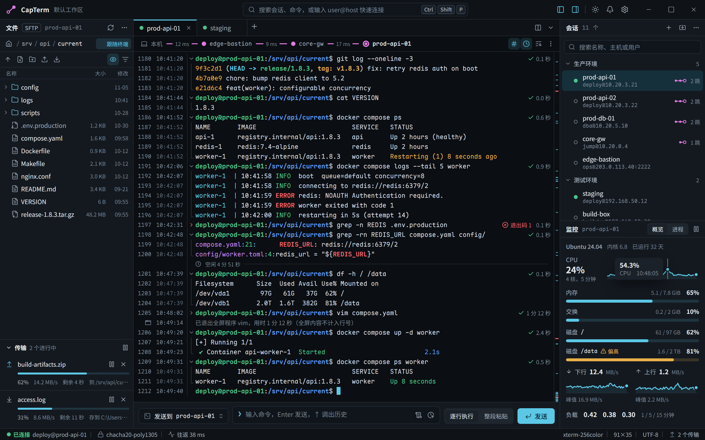
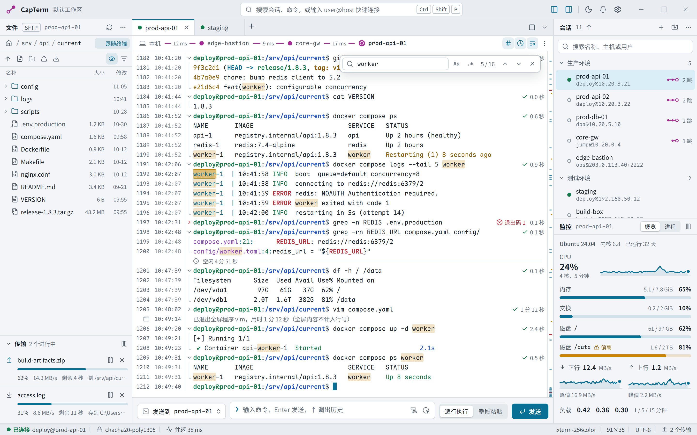
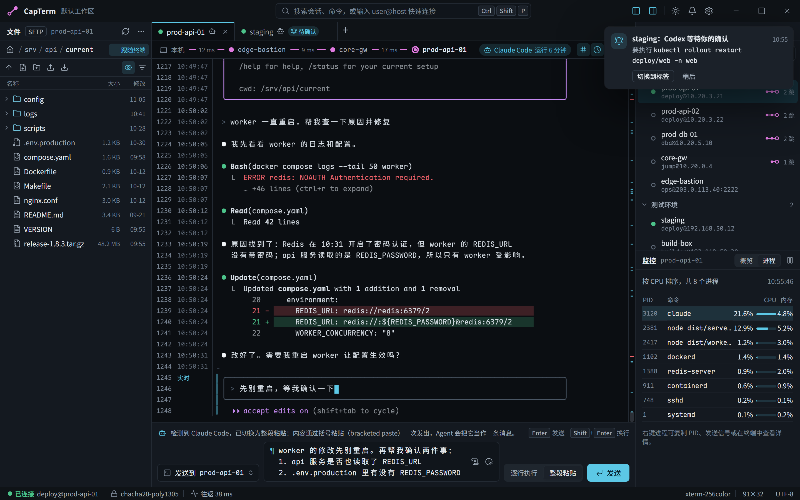
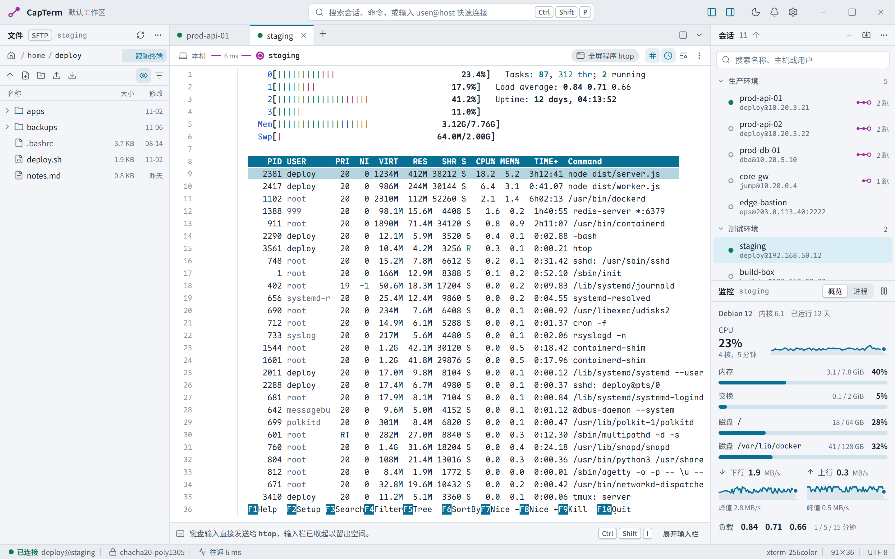
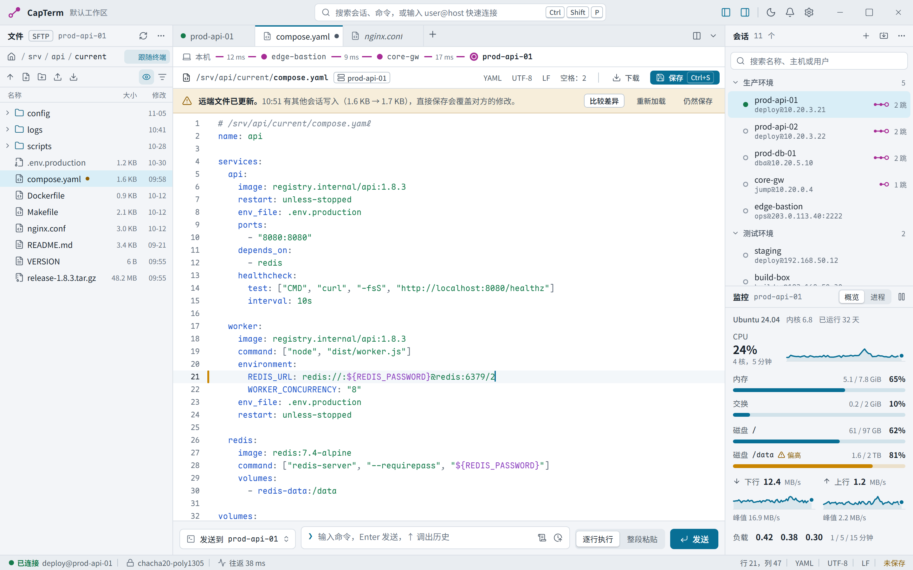
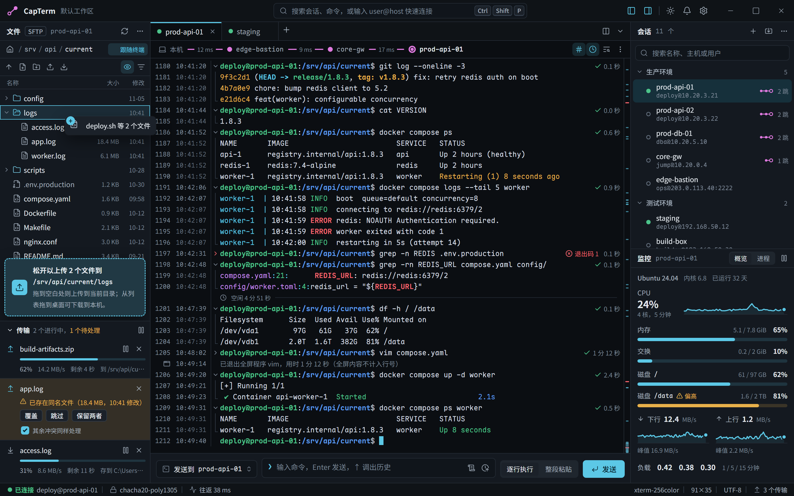
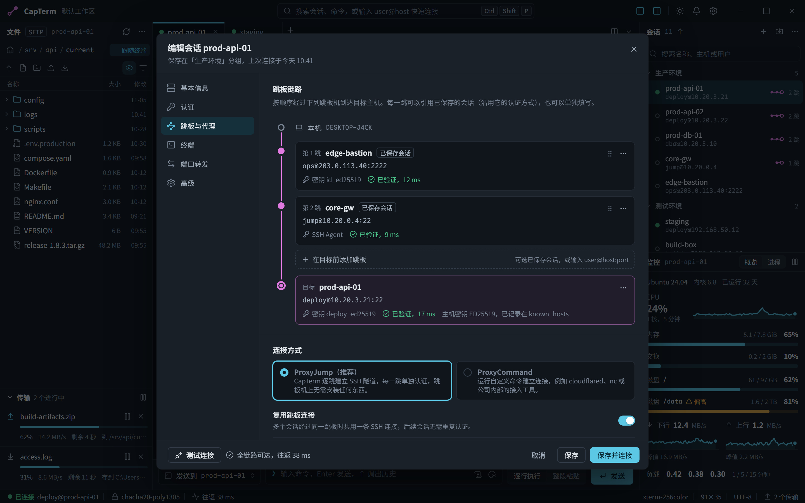
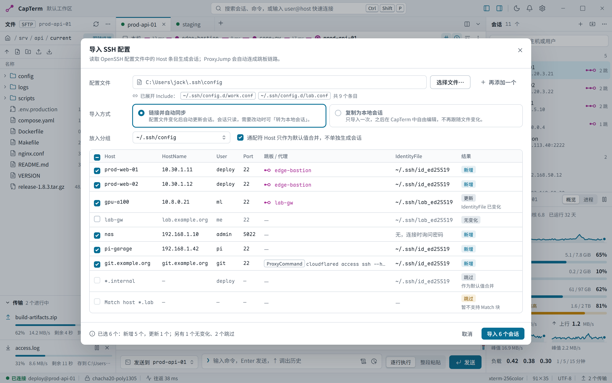
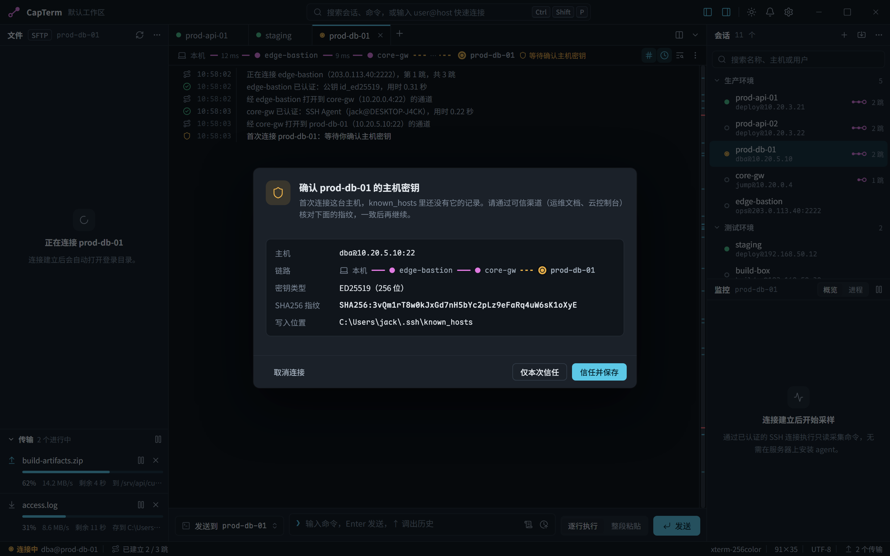
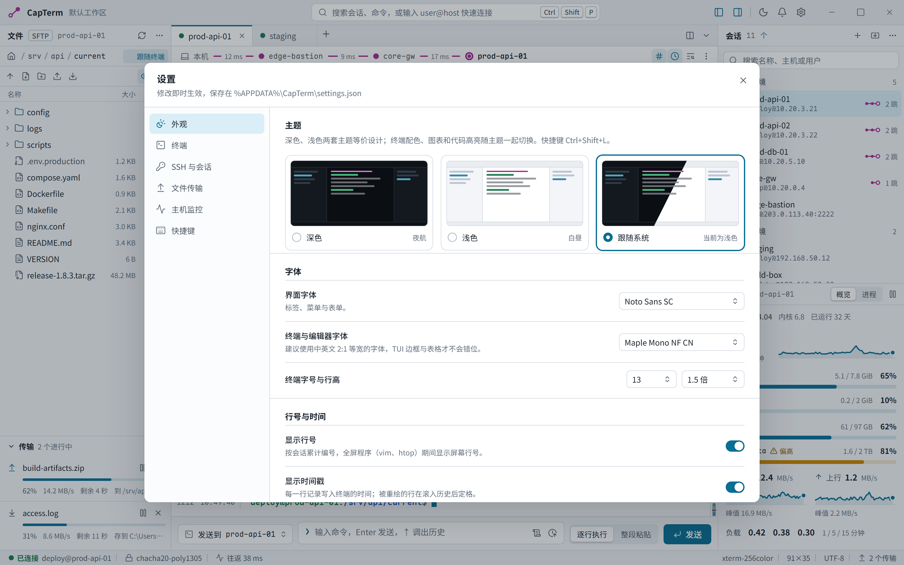
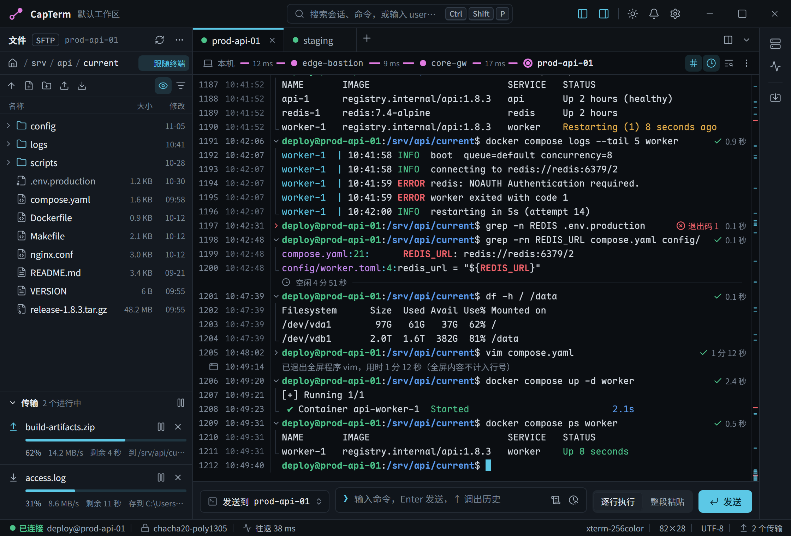

## 12. 文案约定

- 按钮写清楚会发生什么：「保存并连接」「导入 6 个会话」「信任并保存」，不用「确定」「提交」。同一个动作在按钮、提示、日志里用同一个词。
- 错误信息说明哪里出错、怎么处理，例如「core-gw 认证失败（publickey）：检查第 2 跳的私钥，或改用 SSH Agent」，不道歉、不含糊。
- 空状态给出下一步：「连接会话后，这里显示远程主机的文件」。
- 主机名、路径、命令用等宽字体；数字与单位之间留空格（`38 ms`、`1.6 KB`）。

## 13. 待确认

1. 输入栏默认放在终端下方（只跨中间一栏）；如果希望像 WindTerm 那样横跨整个窗口底部，可以改成 `DockPlacement::Bottom` 的停靠面板。
2. 监控默认只采集链路的目标主机，跳板机不采集（设置中可打开）。
3. 首版是否需要串口、Telnet、本地 Shell。当前设计只覆盖 SSH 和 SFTP；本地 Shell 可以复用同一个终端组件。
