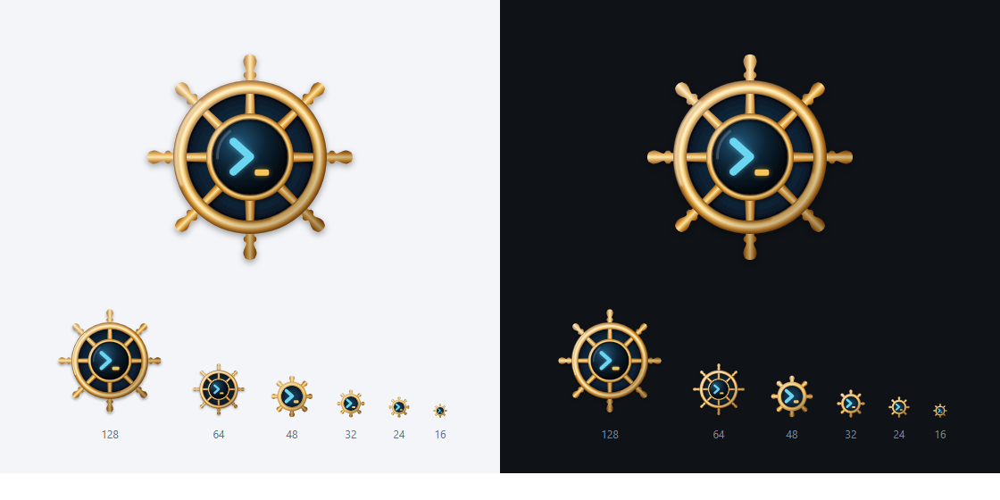

# CapTerm 图标「舵轮」

CapTerm 取自 Captain。船长靠舵轮掌控大船，开发者靠终端掌控远程主机。图标是一只黄铜舵轮，轮毂嵌着一块终端屏幕，屏幕上是命令提示符 `>_`。

- **舵轮**：八根轮辐连着外圈，向外伸出八个车削手柄。一个舵轮同时管着整条船，正如一个工作台管理所有 SSH 会话。
- **终端屏幕**：圆形屏幕位于轮毂中心，青色 `>`、琥珀色光标 `_`。屏幕是整个图标最亮的部分，视线先落在这里。
- **黄铜与深海**：黄铜是航海仪器的传统用料，和界面的石墨黑、仪表青搭配。轮圈内的深蓝是海面，也让舵轮在浅色背景上保持清楚的轮廓。

## 文件

| 文件 | 用途 |
| --- | --- |
| [`capterm-helm.svg`](capterm-helm.svg) | 主稿，用于 64 px 及以上 |
| [`capterm-helm-small.svg`](capterm-helm-small.svg) | 小尺寸稿，用于 16–48 px |
| [`capterm-helm.ico`](capterm-helm.ico) | Windows 图标，含 16、20、24、32、40、48、64、96、128、256 px 十帧 |
| [`png/`](png/) | 透明背景 PNG：16、24、32、48、64、128、256、512、1024 px |
| [`preview.png`](preview.png) | 深浅背景对照与尺寸阶梯 |

修改 SVG 后运行 `node design/tools/export-icon.mjs`，会重新生成 PNG、ICO 和预览图（需要本机装有 Chrome 或 Edge）。

## 小尺寸稿

48 px 以下，主稿的细轮辐和车削手柄会挤成一团，提示符也小到难以辨认。小尺寸稿去掉轮辐和内圈，外圈加粗，手柄改成八个短柄，屏幕占满轮圈内部，提示符随之放大。舵轮的外形和 `>_` 在 16 px 下仍然可辨。

## 颜色

| 部位 | 取值 | 说明 |
| --- | --- | --- |
| 黄铜（暗 → 亮） | `#7A4614` `#C98A2E` `#E2A33E` `#FCE3A0` | 轮辐、手柄横向受光；外圈和轮毂按管状截面受光，左上方另有一层整体主光 |
| 海面 | `#15364E` → `#091725` | 轮圈内部 |
| 屏幕 | `#215677` → `#040A10` | 左上偏亮，模拟玻璃反光 |
| 提示符 `>` | `#6AD6F2` | 界面强调色 `--accent` `#5CC8E6` 提亮一档，外加同色辉光 |
| 光标 `_` | `#F6C65B` | 界面的琥珀色 `--caution` `#E8B04A` 提亮一档 |

图标不使用航线品红，品红在界面里只表示连接链路。

## 接入程序

`build.rs` 通过 `assets/windows/capterm.rc` 把 `design/icon/capterm.ico` 编进 Windows 可执行文件，资源 ID 为 1。启用舵轮图标的方式：

- 把 `capterm.rc` 中的路径改为 `design/icon/helm/capterm-helm.ico`，同时修改 `build.rs` 里 `rerun-if-changed` 指向的文件；或
- 用 `capterm-helm.ico` 覆盖 `design/icon/capterm.ico`。
